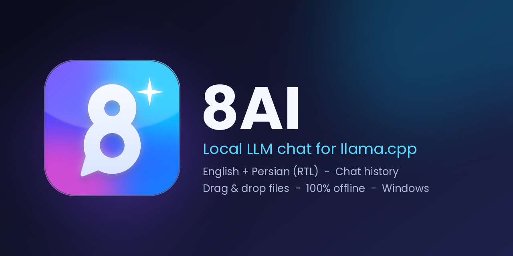
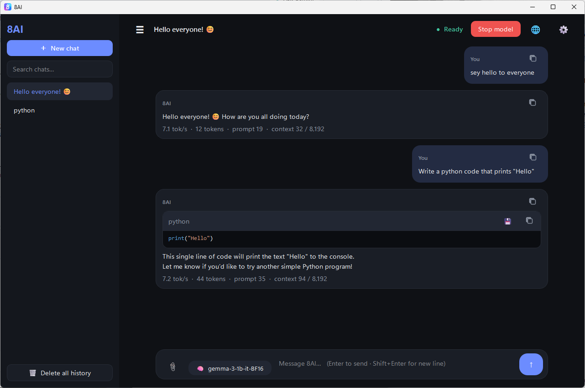

<div dir="rtl">

<p align="center">
  
</p>

<h1 align="center">8AI</h1>

<p align="center">
  یک برنامه‌ی چت دسکتاپ برای اجرای مدل‌های زبانی محلی با <a href="https://github.com/ggml-org/llama.cpp">llama.cpp</a><br>
  کاملاً آفلاین · فارسی + انگلیسی · ویندوز
</p>

[English](README.md)

<p align="center">
  
</p>

## امکانات

- چت با هر مدل **GGUF** از طریق `llama-server` — هیچ داده‌ای از کامپیوترت خارج نمی‌شود
- رابط **فارسی و انگلیسی** (در حالت فارسی چیدمان راست‌به‌چپ می‌شود)
- تاریخچه‌ی گفتگو با جستجو، تغییر نام، حذف و **خروجی Markdown**
- **کشیدن و رها کردن** فایل: متن/کد، PDF، DOCX، XLSX، PPTX، ZIP و تصویر (مدل‌های بینایی)
- تم تیره و روشن و تنظیم اندازه‌ی متن
- پریست‌های نمونه‌برداری (دقیق / متعادل / خلاق) و پارامترهای پیشرفته
- نمایش «فکر کردن» مدل جدا از پاسخ، به‌همراه وضعیت و سرعت
- اسکن پوشه‌ی مدل‌ها و تشخیص خودکار فایل `mmproj`
- **حالت پرتابل** — تنظیمات و چت‌ها کنار فایل exe ذخیره می‌شوند

## پیش‌نیازها

| مورد | نسخه |
|------|------|
| **پایتون** | **۳.۱۰ یا بالاتر** (۳.۱۲ پیشنهاد می‌شود — فایل `.python-version`) |
| سیستم‌عامل | ویندوز ۱۰ / ۱۱ |
| llama.cpp | نسخه‌ی ویندوز که `llama-server.exe` داشته باشد ([دانلود](https://github.com/ggml-org/llama.cpp/releases)) |
| مدل | هر فایل `.gguf` مثل [Gemma 3 1B](https://huggingface.co/unsloth/gemma-3-1b-it-GGUF/tree/main) |

</div>

```bash
python --version
```

<div dir="rtl">

## اجرا از روی سورس

</div>

```bash
git clone https://github.com/Mrmmd2004/8AI.git
cd 8AI

python -m venv .venv
.venv\Scripts\activate

pip install -r requirements.txt
python 8ai.py
```

<div dir="rtl">

بعد وارد **تنظیمات** شو:

1. بخش **موتور** ← پوشه یا زیپ llama.cpp
2. بخش **مدل‌ها** ← پوشه‌ای که فایل‌های `.gguf` داخلش است
3. دکمه‌ی **اجرای مدل** را بزن و چت کن.

برای تصویر، یک مدل بینایی و فایل `mmproj` آن را در تنظیمات انتخاب کن.

## ساخت فایل exe و نصب‌کننده

</div>

```bash
pip install -r requirements-build.txt
python build.py
```

<div dir="rtl">

خروجی‌ها داخل پوشه‌ی `output/` ساخته می‌شوند: نصب‌کننده (`Setup.exe`، نیاز به Inno Setup 6)، نسخه‌ی تک‌فایلی `Portable.exe` و `Portable.zip`.

## محل ذخیره‌ی داده‌ها

- نصب عادی: `C:\Users\<نام شما>\.8ai\`
- پرتابل: پوشه‌ی `data` کنار فایل exe

## لینک‌ها

- گیت‌هاب: [Mrmmd2004](https://github.com/Mrmmd2004)
- تلگرام: [@Clubapp8](https://t.me/Clubapp8)

## لایسنس

[MIT](LICENSE)

</div>
